# Servizi Pilot: guida all'uso

Gestionale per noleggi, assistenze e magazzino. Questa guida spiega come si usa, chi può fare cosa e come si mette in funzione. Gli screenshot arrivano da una demo con dati di prova.

## 1. Chi può fare cosa

L'accesso richiede un nome utente e una password. Ogni utente ha uno di due ruoli.

| Ruolo | Cosa può fare |
|---|---|
| **Amministratore** | Tutto: consultare, creare, modificare, eliminare, sincronizzare con l'ERP, esportare, gestire gli utenti e leggere il registro attività. |
| **Sola lettura** (viewer) | Consultare tutte le pagine ed esportare il calendario. Non può modificare nulla: i campi sono bloccati, i pulsanti di creazione, modifica ed eliminazione non compaiono e il server rifiuta comunque ogni scrittura. |

## 2. Accesso e account

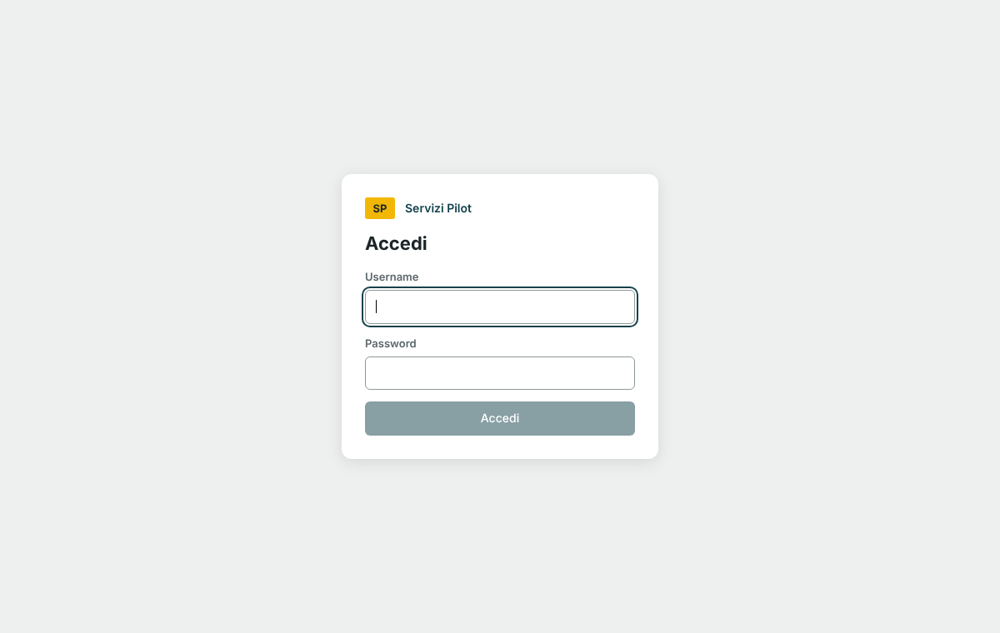

Inserisci username e password. Se la sessione scade o l'utente viene disattivato, l'app riporta al login e, dopo l'accesso, torna alla pagina che stavi aprendo. Dopo 5 tentativi sbagliati l'utente resta bloccato per 5 minuti.

In fondo al menu a sinistra (su telefono, in alto a destra) trovi il tuo nome, il ruolo, **Il mio account** ed **Esci**.

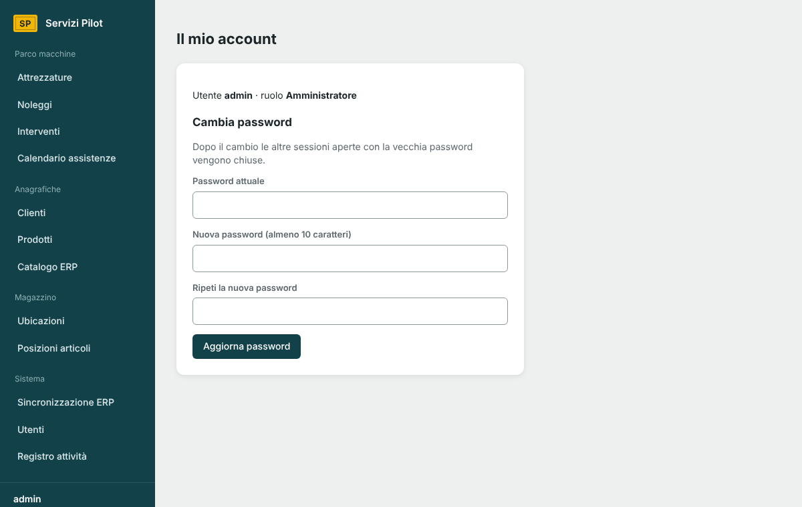

In **Il mio account** puoi cambiare la password (almeno 10 caratteri). Dopo il cambio tutte le sessioni aperte con la vecchia password vengono chiuse e serve un nuovo accesso.

## 3. Clienti e attrezzature: importati o creati a mano

I dati possono arrivare dall'ERP oppure essere inseriti dall'operatore. Nelle scelte del noleggio sono separati in «Importati dall'ERP» e «Creati a mano», così non si confondono.

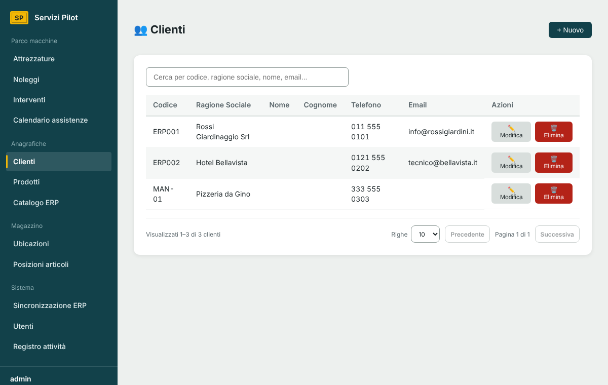

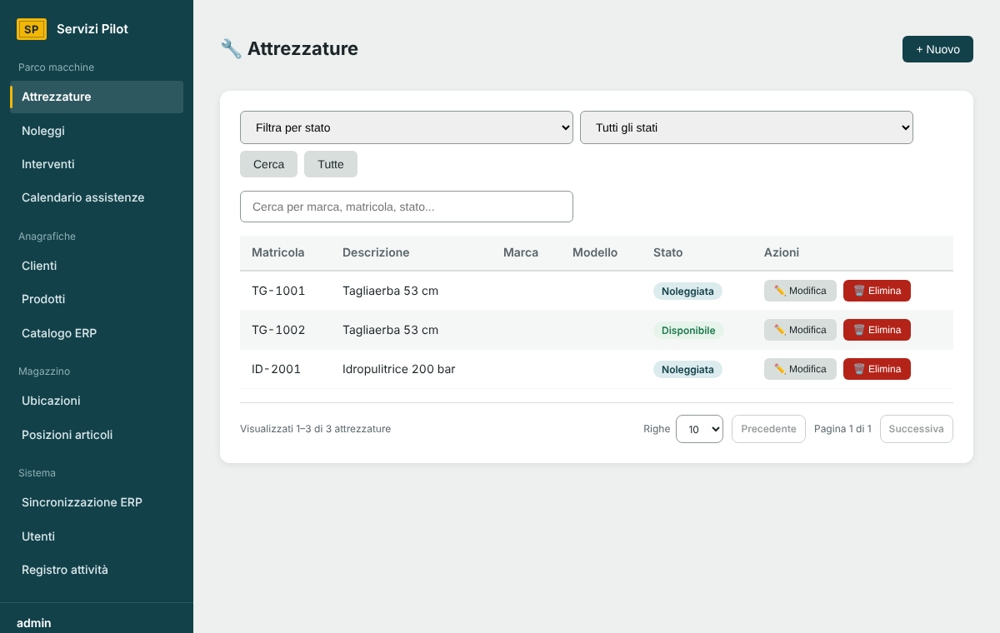

- I clienti e le attrezzature importati si aggiornano con la sincronizzazione ERP (solo amministratori, menu Sistema).
- Un cliente creato a mano ha un codice che inizia per `MAN-` (proposto automaticamente, modificabile).
- Per un cliente importato, le modifiche fatte qui possono essere sovrascritte alla prossima sincronizzazione.

## 4. Noleggi

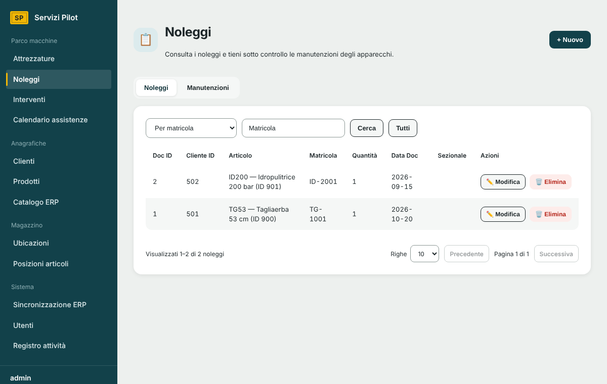

Un noleggio collega un **cliente**, un **articolo** (l'attrezzatura a catalogo) e una **matricola**. Dal dettaglio puoi allegare il PDF del contratto, vedere le manutenzioni e aprire il calendario con il pulsante **Pianifica assistenza**.

### Creare un noleggio con clienti e attrezzature nuovi

Non serve uscire dal form: se il cliente o la macchina non esistono, si creano sul posto e il form si compila da solo.

**Nuovo cliente.** Premi «＋ Nuovo cliente», inserisci codice e ragione sociale (telefono, email e partita IVA sono facoltativi) e premi «Crea e seleziona».

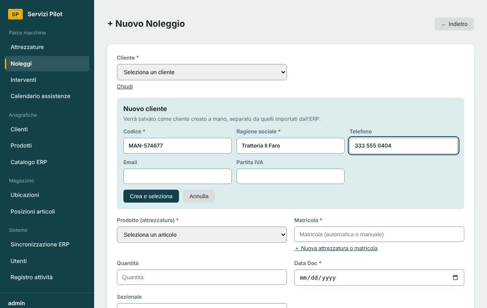

**Nuova attrezzatura o matricola.** Premi «＋ Nuova attrezzatura o matricola».

- Se l'articolo esiste già a catalogo e ne hai scelto uno, puoi aggiungere solo una **nuova matricola**.
- Se non esiste, scegli «Crea un nuovo articolo a catalogo»: inserisci codice e descrizione dell'articolo e la matricola della macchina (marca e modello facoltativi).

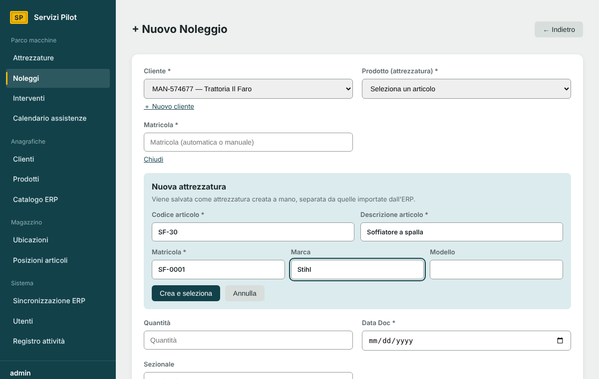

Se l'operazione si interrompe dopo la creazione dell'articolo, un nuovo tentativo lo riusa senza crearne un duplicato.

## 5. Calendario assistenze

Il calendario serve a organizzare le assistenze. Un appuntamento riguarda di norma un **noleggio censito**. Solo in via eccezionale si può inserire un **cliente non censito**, scritto a mano.

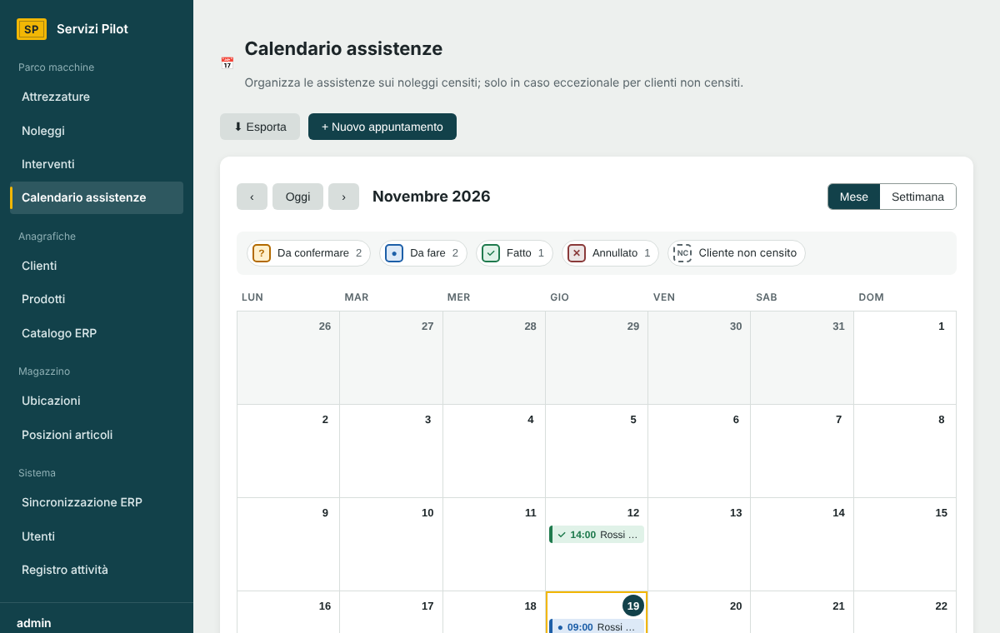

### Colori e legenda

| Stato | Colore | Simbolo |
|---|---|---|
| Da confermare | ambra | `?` |
| Da fare | blu | `●` |
| Fatto | verde | `✓` |
| Annullato | rosso spento, testo barrato | `✕` |
| Cliente non censito | bordo tratteggiato | `NC` |

Ogni stato ha anche un simbolo, quindi il calendario si legge anche senza distinguere i colori. La legenda è anche un filtro: toccando uno stato lo nascondi o lo mostri, e accanto a ogni voce vedi quanti appuntamenti ci sono nel periodo.

### Mese e settimana

Con **Mese** e **Settimana** cambi la vista, con le frecce ti sposti e con **Oggi** torni a oggi. Nella vista mese, se un giorno ha più di tre appuntamenti, «+N altri» apre la settimana di quel giorno.

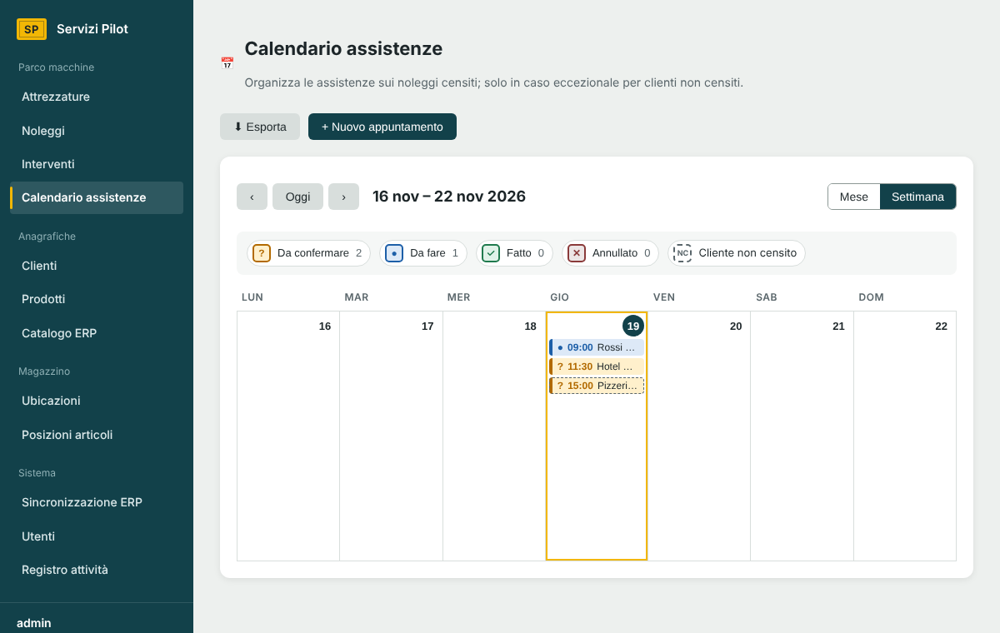

### Creare e modificare un appuntamento

Tocca il numero di un giorno oppure «+ Nuovo appuntamento». Per modificarne uno, toccalo.

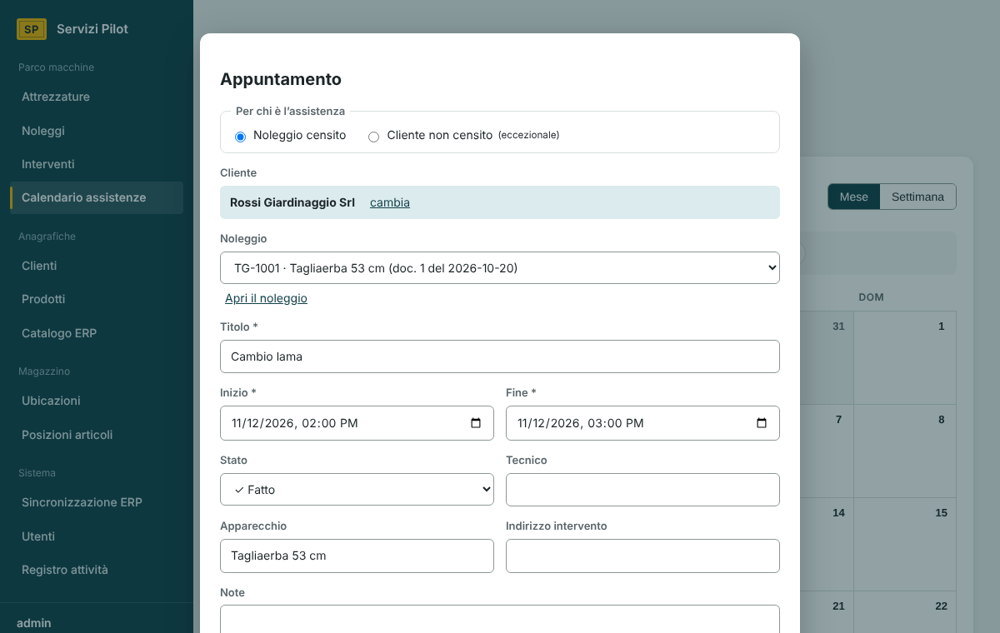

- **Noleggio censito**: cerca il cliente, poi scegli uno dei suoi noleggi. Cliente, telefono e matricola arrivano dall'anagrafica.
- **Cliente non censito**: scrivi nome, telefono e indirizzo a mano.

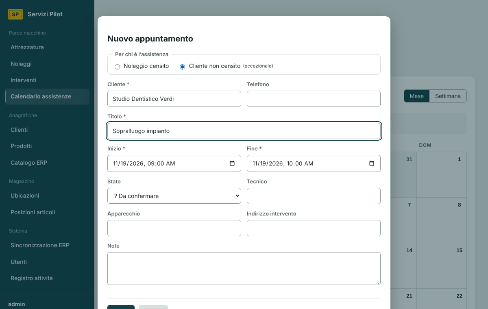

Quando sposti l'inizio, la fine lo segue mantenendo la durata. Per un appuntamento esistente trovi i pulsanti rapidi **Conferma**, **Segna come fatto** e **Annulla appuntamento**; «Annulla» tiene traccia dell'appuntamento, «Elimina» lo cancella.

### Esportare in Excel o PDF

Con **⬇ Esporta** scegli il periodo (giornaliero, settimanale o mensile) e un giorno di riferimento, poi **Excel (.xlsx)** o **PDF**. Sopra i pulsanti vedi le date esatte. Gli stati nascosti nella legenda non finiscono nel file.

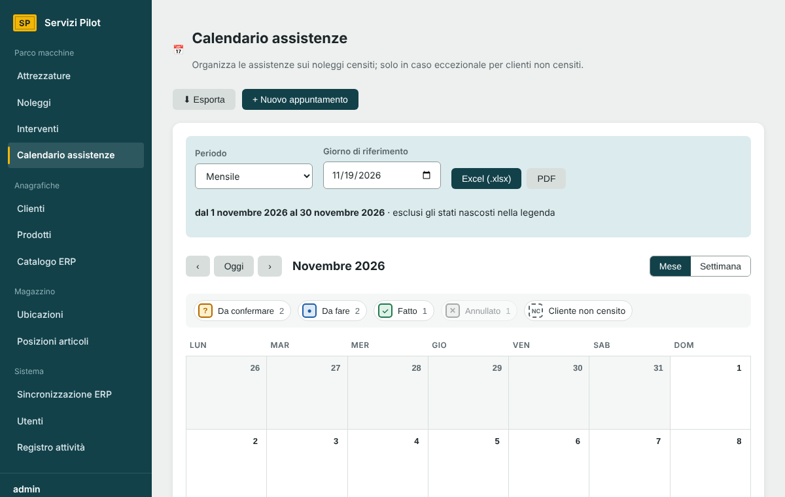

Il PDF raggruppa gli appuntamenti per giorno e riporta gli stati con i colori della legenda. L'Excel ha una riga per appuntamento, filtri attivi e un secondo foglio «Riepilogo» con il conteggio per stato.

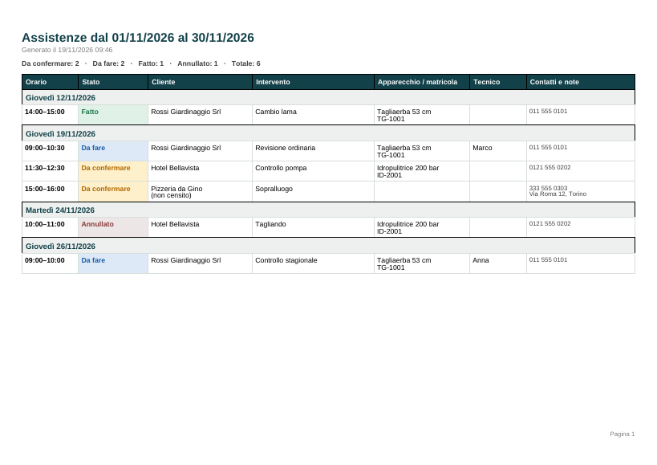

## 6. Utenti (solo amministratori)

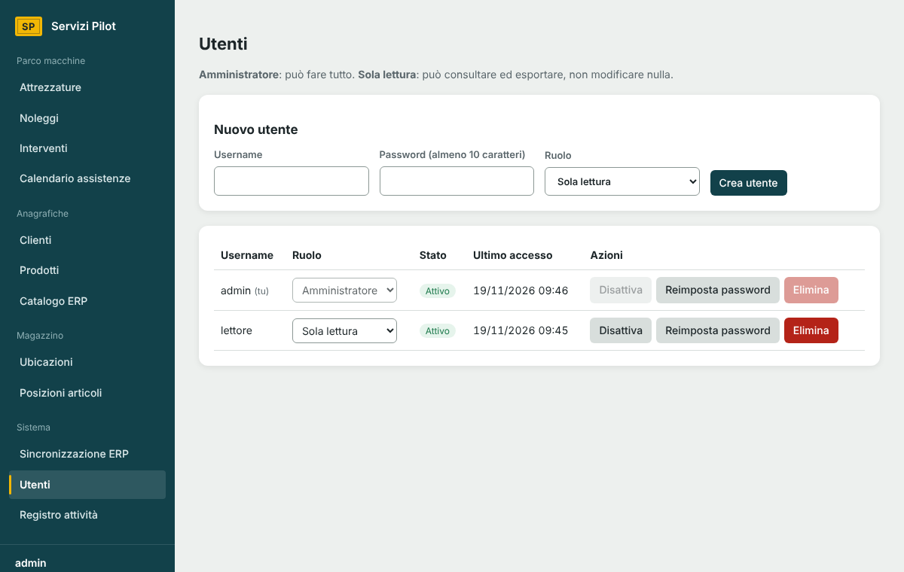

Da **Sistema → Utenti** puoi creare utenti, cambiarne il ruolo, disattivarli e riattivarli, reimpostare la password ed eliminarli. Le regole di sicurezza:

- non puoi cambiare il tuo ruolo, disattivarti o eliminarti;
- deve restare sempre almeno un amministratore attivo;
- la password deve avere almeno 10 caratteri e non coincidere con lo username;
- chi viene disattivato, declassato o ha la password reimpostata perde subito l'accesso con le sessioni già aperte.

## 7. Registro attività (solo amministratori)

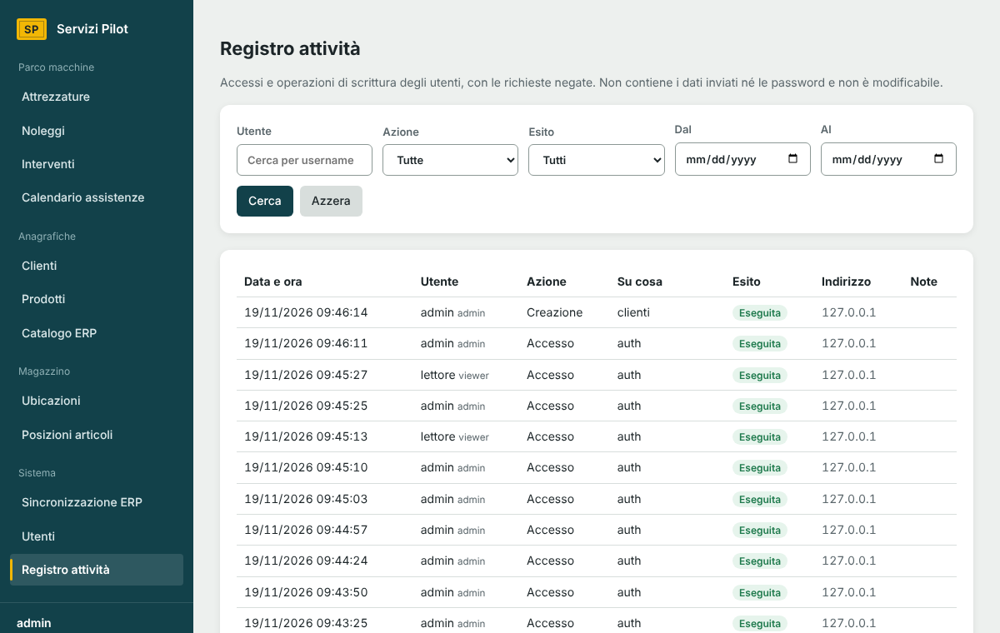

Il registro dice chi ha fatto cosa e quando: accessi (riusciti, falliti, bloccati), cambi password, creazioni, modifiche, eliminazioni ed esportazioni, comprese le richieste **negate** (per esempio un viewer che prova a scrivere). Si filtra per utente, azione, esito e periodo.

Non contiene i dati inviati né le password e non si può modificare né svuotare. Di un accesso fallito si conserva lo username solo se ha la forma di uno username. Gli indirizzi IP sono dati personali: stabilisci per quanto tempo conservare il registro.

## 8. Come lo vede un utente a sola lettura

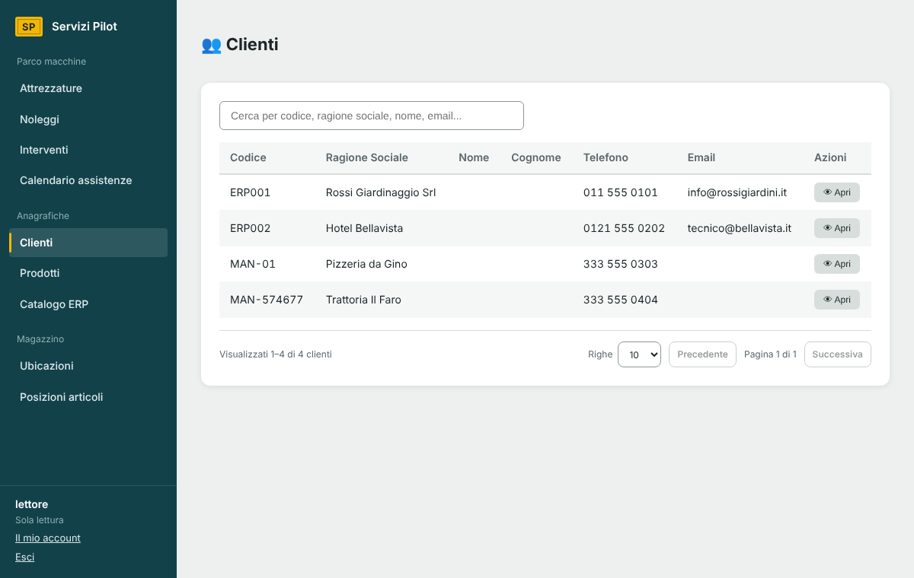

Nell'elenco al posto di «Modifica» c'è «Apri». Le pagine di creazione, la sincronizzazione ERP, gli utenti e il registro non sono accessibili.

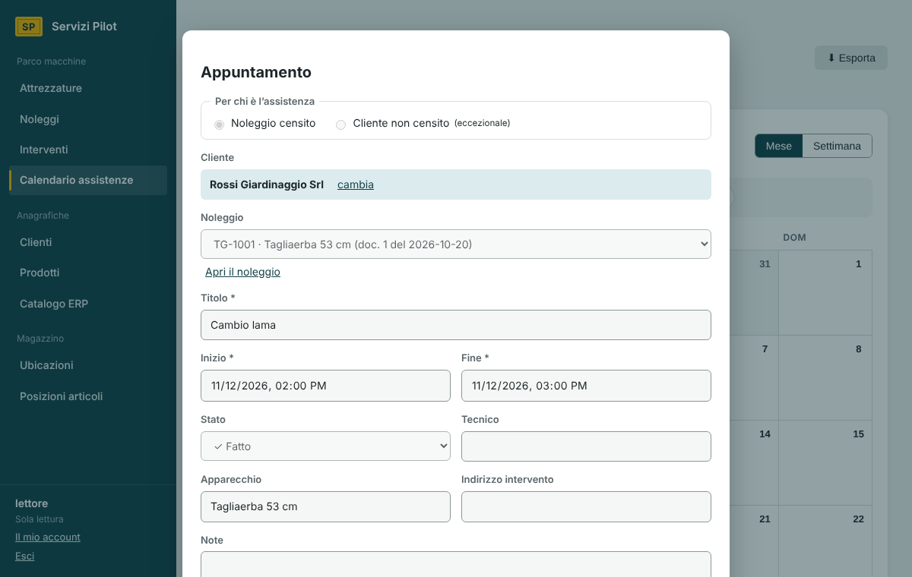

I dettagli si leggono ma i campi sono bloccati e non ci sono pulsanti per salvare, annullare o eliminare.

## 9. Da smartphone

L'app si usa anche dal telefono: il menu diventa una barra che scorre di lato e in alto a destra restano sempre nome utente ed **Esci**. Le tabelle larghe scorrono di lato dentro la loro scheda.

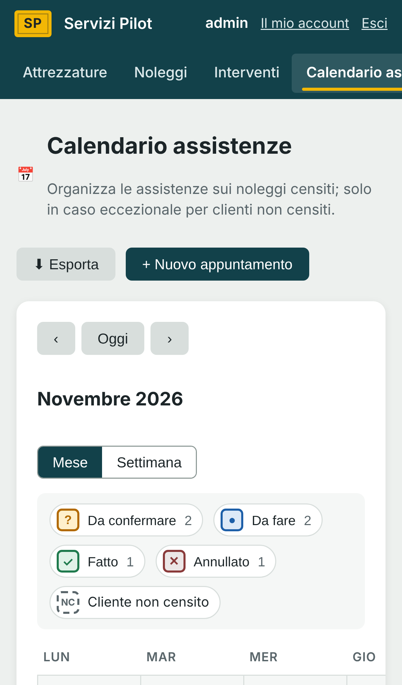

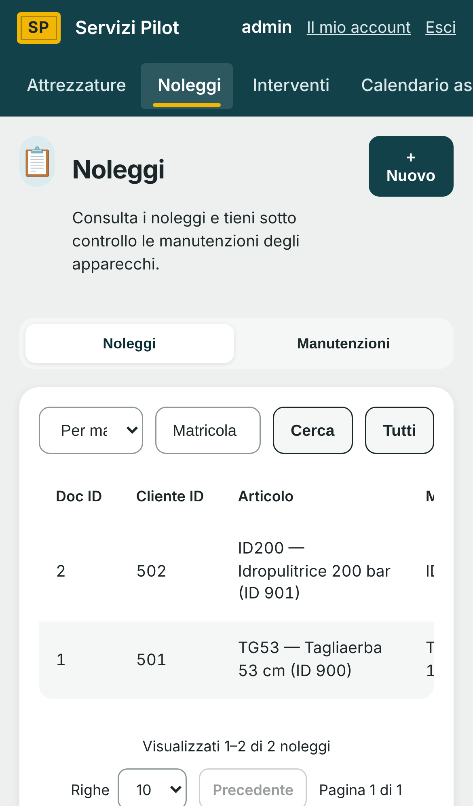

---

# Per chi installa e gestisce il sistema

## 10. Architettura

| Parte | Tecnologia | Porta predefinita |
|---|---|---|
| Backend (`Service_Machine_BE`) | Java 21, Spring Boot 3.4, JPA/Hibernate, Flyway, Spring Security (token JWT) | 8082 |
| Frontend (`Service_Machine_FE`) | Angular 19 | 4200 in sviluppo |
| Database | MySQL 9 (schema `service`); H2 in memoria solo per i test | 3306 |
| Microservizio ERP | esterno ai due repository: popola clienti, catalogo e attrezzature | 3000 |

In sviluppo il frontend inoltra le chiamate `/api` al backend con `proxy.conf.json`. Il backend pubblica la documentazione delle API su `/swagger-ui.html`.

## 11. Configurazione del backend

| Variabile | Predefinito | Uso |
|---|---|---|
| `JWT_SECRET` | **nessuno, obbligatoria** | Segreto per firmare i token: almeno 32 caratteri casuali. Senza, il backend non parte. |
| `JWT_TTL_MINUTES` | `480` | Durata del token (8 ore). |
| `ADMIN_USERNAME` | `admin` | Username del primo amministratore. |
| `ADMIN_PASSWORD` | generata | Password del primo amministratore. Se manca viene generata e scritta una sola volta nel log. |
| `DB_URL`, `DB_USERNAME`, `DB_PASSWORD` | solo sviluppo | Connessione a MySQL. |
| `SYNC_SERVICE_URL`, `SYNC_API_TOKEN` | `http://localhost:3000/api/sincronizza` | Microservizio ERP. |
| `FLYWAY_ENABLED` | `true` | Migrazioni automatiche all'avvio. |

Il primo amministratore viene creato all'avvio solo se non esistono utenti. Annota la password e cambiala subito dalla pagina **Il mio account**.

## 12. Migrazioni del database

Flyway applica all'avvio le migrazioni in `src/main/resources/db/migration`. Fai un backup e provale prima su una copia del database.

| Versione | Cosa fa |
|---|---|
| V3 | Tabella `appuntamenti_assistenza` (calendario). |
| V4 | Colonna `origine` su `local_clienti` (ERP o MANUALE). |
| V5 | Tabella `utenti`. |
| V6 | Tabella `registro_attivita`. |

I clienti e gli articoli creati a mano hanno id a partire da **1.000.000.000**, per non collidere con quelli dell'ERP. Verifica che gli id dell'ERP restino sotto quella soglia e che la sincronizzazione lasci stare le righe `MANUALE`.

## 13. Sicurezza in breve

- Ogni chiamata a `/api/**` richiede un token. Le letture (`GET`) sono per amministratori e viewer, ogni altro metodo solo per gli amministratori.
- Il ruolo si rilegge dal database a ogni richiesta: disattivare o declassare un utente ha effetto subito. Il cambio password invalida i token emessi prima.
- Le password sono salvate solo come hash BCrypt e non compaiono mai nei log né nel registro.
- Esponi il servizio solo su HTTPS: il token viaggia a ogni richiesta.
- Il token è conservato nel browser (`localStorage`) e dura 8 ore.

## 14. Avvio e test

```bash
# backend
cd Service_Machine_BE
export JWT_SECRET='...almeno 32 caratteri casuali...' ADMIN_PASSWORD='...'
mvn spring-boot:run

# frontend
cd Service_Machine_FE
npm ci
npm start            # http://localhost:4200

# test
mvn test             # backend
npm test             # frontend
```
